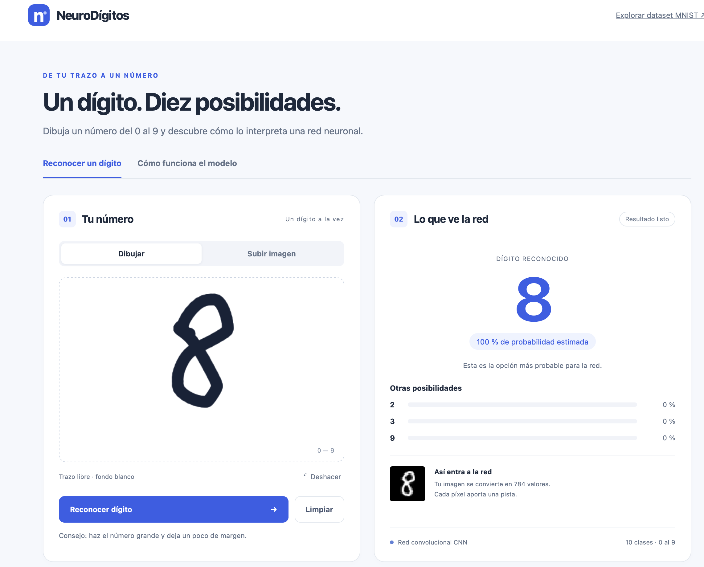
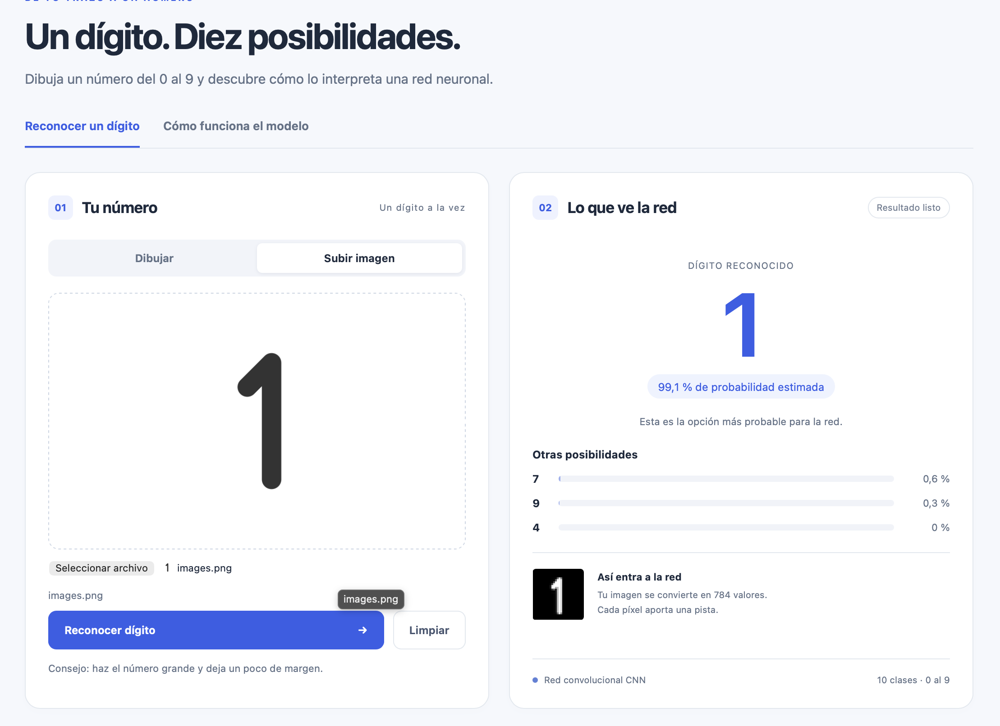
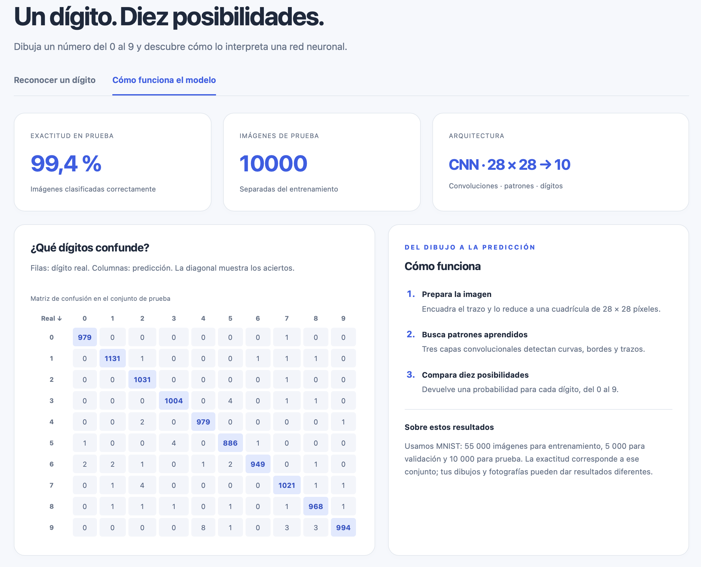
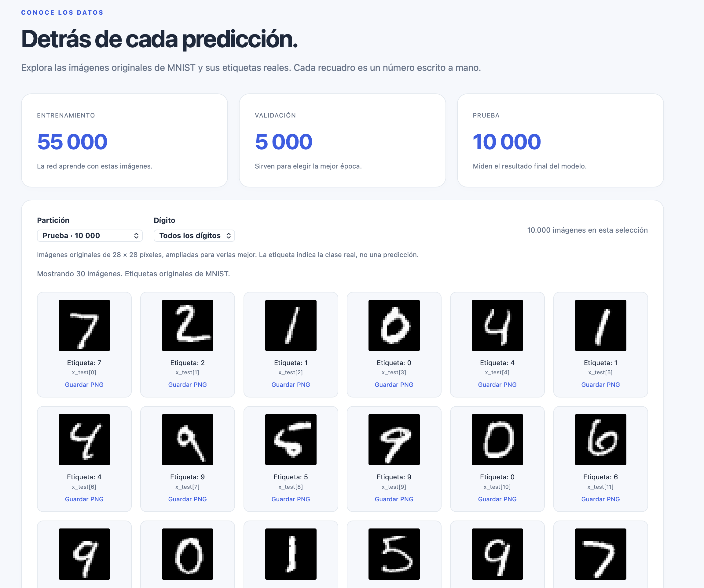

# NeuroDígitos: reconocimiento del 0 al 9

Reconocimiento de dígitos manuscritos con una **red convolucional (CNN) en PyTorch**, entrenada con MNIST, e interfaz web local en HTML, CSS y JavaScript.

## Capturas de la aplicación

### Reconocer un dígito dibujado



### Reconocer un dígito desde una imagen



### Evaluación del modelo



### Explorador del conjunto MNIST



## Iniciar

Desde la carpeta del proyecto:

```bash
python3 -m venv .venv
source .venv/bin/activate
python -m pip install -r requirements.txt
python servidor.py
```

Abre **http://127.0.0.1:8000**. Mantén la terminal abierta; pulsa **Ctrl+C** para detener el servidor. Si el puerto está ocupado: `python servidor.py --puerto 8001`.

Si ya está instalado, basta con activar el entorno y ejecutar `python servidor.py`. En Windows activa con `.venv\Scripts\Activate.ps1` en PowerShell. En VS Code selecciona el intérprete del entorno `.venv`.

La aplicación incluye el modelo `modelo_digitos.pt`. Si no existe, ejecuta primero `python entrenar.py`. La primera preparación de MNIST necesita Internet para descargar 11 MB; después funciona sin conexión. No necesita Node.js ni envía tus dibujos a servicios externos.

## Uso

1. En **Dibujar**, traza un solo dígito con el ratón o el dedo. **Deshacer** elimina el último trazo y **Limpiar** reinicia la entrada.
2. También puedes **Subir imagen**: selecciona o arrastra un PNG/JPG de hasta 5 MB y 16 megapíxeles.
3. Pulsa **Reconocer dígito** para ver la predicción, la probabilidad estimada, otras posibilidades y la imagen de 28 × 28 que recibe la red.
4. **Probar un ejemplo** clasifica una imagen del conjunto de prueba y muestra su etiqueta real.
5. **Cómo funciona el modelo** muestra la exactitud de prueba, la matriz de confusión y una explicación del proceso.

Usa un fondo uniforme, un solo dígito y márgenes alrededor. La probabilidad estimada no garantiza un acierto. Fotografías con fondos complejos, varios números o escritura diferente de MNIST pueden fallar.

## Qué mejoró

- **28 × 28 píxeles**, frente a los 8 × 8 del modelo anterior: conserva más detalle.
- **MNIST**: 60 000 imágenes de desarrollo y 10 000 de prueba. De las primeras, se reservan 5 000 para validación; las 55 000 restantes entrenan la red.
- **CNN**: tres convoluciones con 24, 48 y 64 filtros, dos reducciones por max pooling y una capa de 128 neuronas con dropout del 30 %. Diez logits de salida, convertidos a probabilidades mediante softmax.
- **Preparación compartida** entre entrenamiento e interfaz: corrección de orientación EXIF, transparencia, detección de polaridad por el borde, eliminación de ruido pequeño, recorte, ajuste proporcional a 20 píxeles y centrado por centro de masa en un lienzo de 28 × 28.
- **Aumento de datos** solo en entrenamiento: giros de aproximadamente ±12°, cambios de escala, desplazamiento, inclinación y variaciones suaves de grosor.
- **Selección por validación**: se conserva la época de menor pérdida de validación. El conjunto de prueba se evalúa al finalizar y no decide el modelo.
- Pesos PyTorch guardados con versión del preprocesamiento; ya no se carga el archivo scikit-learn incompatible para reconocer.

## Entrenar y evaluar

```bash
python entrenar.py --epocas 10
python evaluar.py
python evaluar_robustez.py
python -m unittest test_motor.py test_servidor.py
```

También funciona `python evaluar.py --reentrenar`. Reinicia el servidor después de entrenar para que cargue los nuevos pesos.

El entrenamiento usa semilla 42, AdamW, lotes de 256 y una tasa de aprendizaje que baja de 0,001 a 0,0001. Elige automáticamente MPS cuando está disponible en macOS; puedes forzar `--dispositivo cpu`. La reproducción exacta puede variar entre dispositivos/versiones.

`metricas_entrenamiento.json` registra cada época, la mejor época, la partición, la exactitud y la matriz de prueba. `comparacion_modelos.json` compara la antigua MLP y la nueva CNN con las mismas 10 000 imágenes MNIST, y con 1 000 variantes deterministas (escala, posición, rotación, grosor y polaridad) del conjunto de prueba. Estas variantes son una comprobación sintética, no una medición sobre dibujos reales del usuario. El modelo antiguo se conserva exclusivamente para esta comparación; puede emitir advertencias de versión de scikit-learn.

## Archivos

- `motor.py`: CNN, inferencia, preprocesamiento y datos MNIST.
- `entrenar.py`: entrenamiento con aumento de datos y selección por validación.
- `modelo_digitos.pt`: pesos de la nueva red y metadatos.
- `metricas_entrenamiento.json`: resultados reproducibles del entrenamiento.
- `servidor.py` y `web/`: API local e interfaz web.
- `evaluar.py`: métricas por dígito desde terminal.
- `evaluar_robustez.py`: comparación de ambos modelos sin reentrenarlos.
- `test_motor.py`, `test_servidor.py`: pruebas de preparación e integración HTTP.
- `datos/`: descarga MNIST y caché de imágenes preparadas.
- `app.py`: interfaz de escritorio alternativa, actualizada para la CNN (requiere Tkinter).
- `modelo_digitos.joblib`: modelo MLP anterior para comparación, no utilizado por la aplicación.

## Fuente de datos

[MNIST en Keras](https://keras.io/api/datasets/mnist/) contiene 60 000 imágenes de entrenamiento y 10 000 de prueba de 28 × 28. Se descarga la copia publicada por Keras en Google Storage y se verifica su SHA-256. Según la [documentación del cargador de Keras](https://github.com/keras-team/keras/blob/master/keras/src/datasets/mnist.py), MNIST se distribuye bajo CC BY-SA 3.0, con atribución a Yann LeCun y Corinna Cortes.

## Documentación IEEE y acceso al dataset

- Informe LaTeX: `docs/ieee/main.tex`.
- PDF: `docs/ieee/main.pdf`.
- Proyecto para subir a Overleaf: `docs/NeuroDigitos_IEEE.zip`.
- Instrucciones de edición y compilación: `docs/ieee/LEEME.md`.
- Guía del dataset y ejemplo de lectura en Python: `docs/DATASET.md`.
- Explorador local de imágenes originales: **http://127.0.0.1:8000/dataset**.

Completa los datos personales en `docs/ieee/autores.tex` antes de entregar. Las cifras del informe corresponden a la ejecución documentada; si vuelves a entrenar, actualiza también las figuras y el texto.
